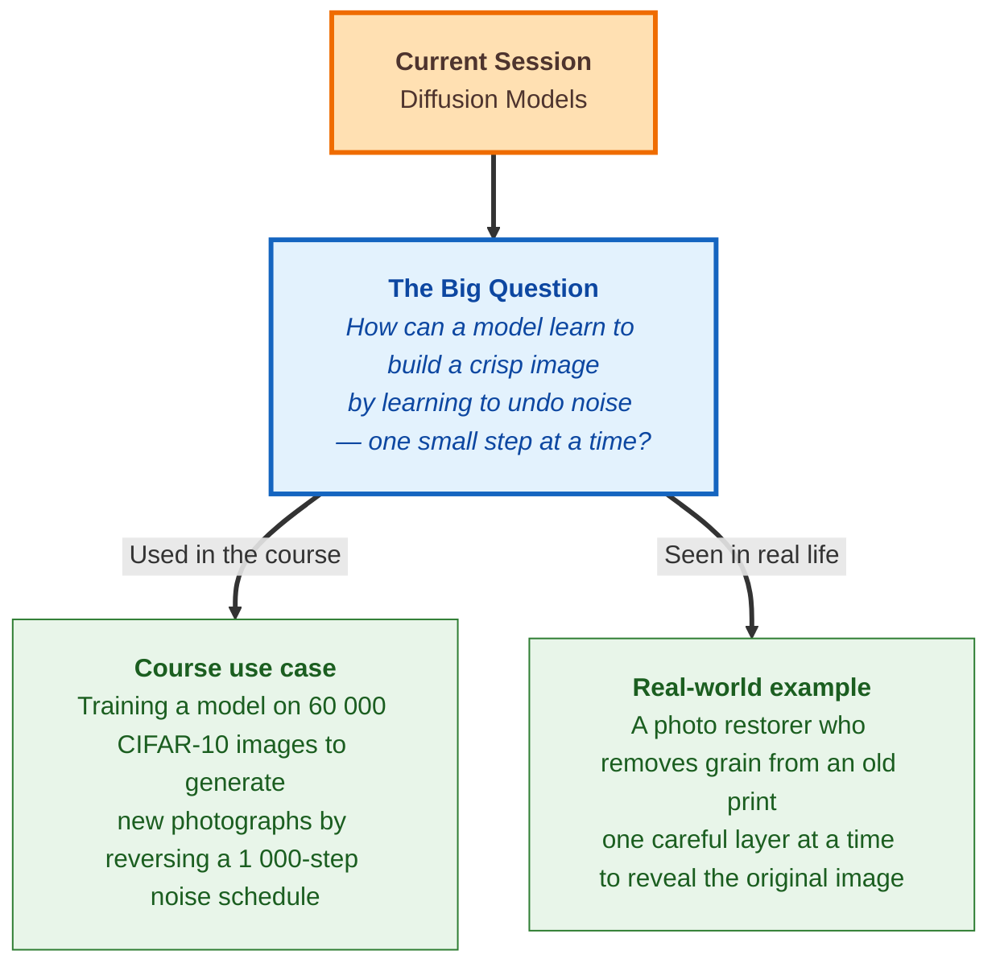

## <span style="color:#2F7DDE">Diffusion Models</span>

### <span style="color:#2F7DDE">Mental Map</span>



---

### <span style="color:#2F7DDE">What You'll Learn</span>

Have you ever wondered how a photo restorer uncovers a hidden image? She lifts one layer at a time.

By the end of this session, you will be able to:

- <span style="color:#D9660B">**Identify**</span> why the noise-removal network must see the whole image and its fine edges at once.
- <span style="color:#D9660B">**Describe**</span> how a clean image becomes pure noise across 1 000 steps, each adding a sprinkle of grain.
- <span style="color:#D9660B">**Explain**</span> how a model walks that path in reverse and recovers a sharp image from noise.
- <span style="color:#D9660B">**Compare**</span> the step-by-step restoration approach to the two-player method from earlier sessions.

> <span style="color:#2F7DDE">**Topics you will meet:**</span> Diffusion process: forward noise addition and reverse denoising; UNet as the denoising network.
>
> Join the session to learn each of these in detail.

---

### <span style="color:#2F7DDE">Why You Are Learning This Topic</span>

Imagine a box of old family photographs buried under dust and grain. A skilled restorer does not wipe everything off at once. She removes one thin layer, checks what appears, then removes the next.

A <span style="color:#D9660B">**diffusion model**</span> means a model that creates images by reversing a layered noise process.

You already know the two-player approach from earlier sessions. This is the other main family powering today's text-to-image tools.

> <span style="color:#2F7DDE">**Think about it:**</span> Would you teach restoration by showing damaged prints? Or by watching each layer of damage being added?

---

### <span style="color:#2F7DDE">The Photo Restorer Puzzle</span>

A restorer grades three prints on a 0-to-10 grain scale.

| Print | Artist | Grain level |
|:------|:-------|:-----------:|
| Street scene, 1943 | Leila | 5 |
| Mountain at dawn | Chen | 7 |
| Studio still-life | Omar | 10 |

<span style="color:#D9660B">**What you want to happen:**</span>

- Start from Omar's print at grain level 10 and produce a sharp image.
- At grain level 5, predict only the noise added since level 4.
- Do this without a second network as a critic.

Here is how it might start. You do not need to understand it yet.

```python
noisy = original + noise_scale[timestep] * random_noise
predicted_noise = unet(noisy, timestep)
```

> <span style="color:#D9660B">**Wonder about this:**</span>
>
> - The model trains only on noisy prints. How does it learn what a clean print looks like?
> - Why does the restorer need to know her step number, not the print's appearance?

---

### <span style="color:#2F7DDE">Think It Through</span>

There is no wrong first try. Keep your guesses for the session.

**1. Omar's print reaches grain level 10 in 10 steps. What does the model predict at step 9 to reach level 9?**
Hint: what changed between steps 8 and 9 going forward?

**2. The restorer's tool shrinks to find big shapes, then expands to fill fine cracks. Why does grain differ at large and small scales?**
Hint: a wide sky and a single hair carry different grain patterns.

**3. The two-player approach needs a generator and a critic. The restorer trains alone. What does she not need?**
Hint: the noise at each step is recorded — the target is always known.

---

### <span style="color:#2F7DDE">One Question to Carry Into the Session</span>

> <span style="color:#2F7DDE">**The model only predicts noise at one step. Does it ever see the clean image it is working toward?**</span>
>
> If not — how does it still manage to generate one?
