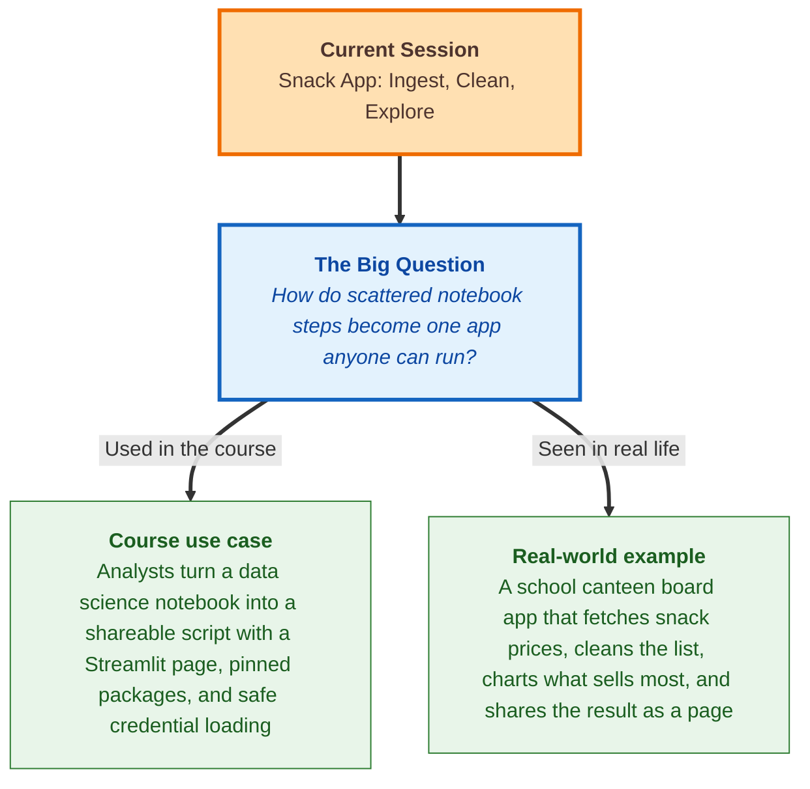

## <span style="color:#2F7DDE">Snack App: Ingest, Clean, Explore</span>

### <span style="color:#2F7DDE">Mental Map</span>



---

### <span style="color:#2F7DDE">What You'll Learn</span>

Have you ever wondered how a canteen board always shows today's prices, with no one updating it by hand?

By the end of this session, you will be able to:

- <span style="color:#D9660B">**Demonstrate**</span> how a notebook becomes a runnable canteen script from one command.
- <span style="color:#D9660B">**Apply**</span> an ordered cleaning sequence so duplicates and missing prices no longer appear.
- <span style="color:#D9660B">**Use**</span> a hidden file to load the canteen credential at run time.
- <span style="color:#D9660B">**Solve**</span> a failed price pull so one bad response does not stop the whole run.
- <span style="color:#D9660B">**Build**</span> a filtered page that shows the cleaned snack list and its price charts.
- <span style="color:#D9660B">**Write**</span> a requirements file that pins every package the canteen app needs.

> <span style="color:#2F7DDE">**Topics you will meet:**</span> notebook-to-script conversion, ingest → clean → EDA → share flow, .env file and credential loading, try/except for a failed API pull, Streamlit with filter and charts, requirements.txt with pinned versions.
>
> Join the session to learn each of these in detail.

---

### <span style="color:#2F7DDE">Why You Are Learning This Topic</span>

You built a school canteen board in steps: one notebook fetches prices, another cleans them, and a third charts them. The manager now wants all three to run every morning without anyone opening notebooks by hand. A <span style="color:#D9660B">**pipeline**</span> means a fixed sequence of steps that runs start to finish without manual help. One script, one command, same result every time. That is how notebook work becomes a project you can share on GitHub.

> <span style="color:#2F7DDE">**Think about it:**</span> If the canteen price service is down, should the whole run crash? Or should it skip the pull and use yesterday's data?

---

### <span style="color:#2F7DDE">The Canteen Board Puzzle</span>

The canteen price service returned these rows this morning.

| Item | Price (₹) | Category |
|:----:|:---------:|:--------:|
| samosa | 12 | snack |
| Samosa | 12 | snack |
| Chai | 8 | drink |
| Vada Pav | 15 | snack |
| vada pav | — | snack |

<span style="color:#D9660B">**What you want to happen:**</span>

- Remove the duplicate rows so each item appears once.
- Replace the missing price with the correct value from the matching row.
- Display a bar chart of snack prices on a filtered page.

Here is how the cleaning step might start.

```python
df.drop_duplicates(subset='name', inplace=True)
df['price'] = df['price'].fillna(0.0)
print(df[['name', 'price']].head(3))
```

> <span style="color:#D9660B">**Wonder about this:**</span>
>
> - If the credential is wrong and the price pull fails, what should the script do next?
> - Would pinning a package version today protect the canteen board from breaking next month?

---

### <span style="color:#2F7DDE">Think It Through</span>

There is no wrong first try. Keep your guesses for the session.

**1. The canteen price service is down. The script reaches the fetch step. What should happen next?**
Hint: Think about how a script can catch one failure and keep going.

**2. The cleaning notebook has 12 cells in a custom order. How do you turn that into a safe script?**
Hint: Think about what changes when cells become function calls in a fixed order.

**3. A friend clones your canteen repo. They have no credentials. How does your app tell them what they need?**
Hint: Think about the file that names each required variable but leaves the values blank.

---

### <span style="color:#2F7DDE">One Question to Carry Into the Session</span>

> <span style="color:#2F7DDE">**How do you turn five scattered notebooks into one app a stranger can clone and run?**</span>
>
> Which single file should they read first?
