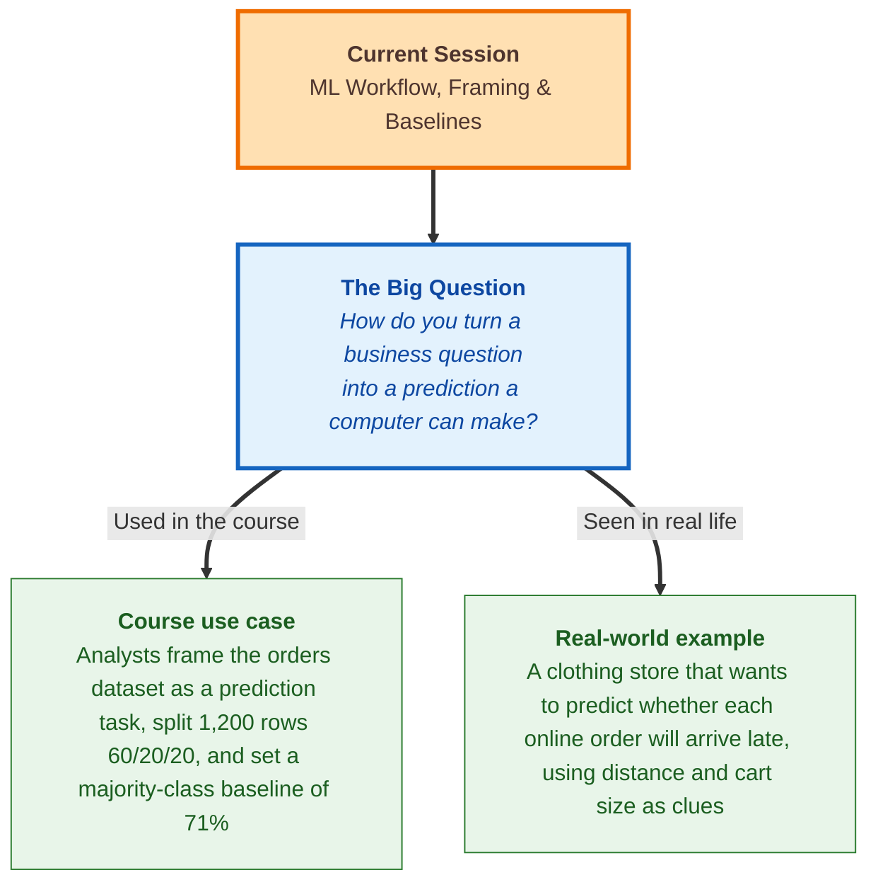

## <span style="color:#2F7DDE">ML Workflow, Framing &amp; Baselines</span>

### <span style="color:#2F7DDE">Mental Map</span>



---

### <span style="color:#2F7DDE">What You'll Learn</span>

Have you ever wondered how an online shop predicts your delivery date before the parcel leaves the warehouse?

By the end of this session, you will be able to:

- <span style="color:#D9660B">**Identify**</span> the target column, the input columns, and the unit of analysis in the orders table.
- <span style="color:#D9660B">**Describe**</span> the stages a prediction project follows from the first business question to a live answer.
- <span style="color:#D9660B">**Classify**</span> the orders problem as a yes/no problem or a number problem by reading its answer column.
- <span style="color:#D9660B">**Apply**</span> the fill-gaps, fit, and predict steps to an orders table with one missing distance value.
- <span style="color:#D9660B">**Determine**</span> the score a trained model must beat before it replaces the simple guess.
- <span style="color:#D9660B">**Build**</span> a three-way data split with a fixed number so the split is the same every run.

> <span style="color:#2F7DDE">**Topics you will meet:**</span>
> ML workflow and habits — problem framing — regression vs classification.
> The scikit-learn fit/transform/predict interface — train/validation/test split — baselines.
>
> Join the session to learn each of these in detail.

---

### <span style="color:#2F7DDE">Why You Are Learning This Topic</span>

You place a clothing order and get a message: arrives Tuesday. How did the shop know? It did not guess at random. Someone taught a computer to look at past orders and spot patterns. An <span style="color:#D9660B">**ML workflow**</span> means the fixed sequence of steps from framing a business question to shipping a prediction. This course follows that same sequence on a real orders table.

> <span style="color:#2F7DDE">**Think about it:**</span> If the shop always guessed "on time" for every order, how often would it be right? Would that qualify as a reliable prediction?

---

### <span style="color:#2F7DDE">The Late Order Puzzle</span>

A clothing shop logged five recent orders. One distance value is missing.

| Order ID | Distance (km) | Items in cart | Day placed | Late? |
|:--------:|:-------------:|:-------------:|:----------:|:-----:|
| ORD-101 | 12.4 | 3 | Monday | No |
| ORD-102 | 28.0 | 1 | Friday | Yes |
| ORD-103 | — | 5 | Wednesday | No |
| ORD-104 | 9.7 | 2 | Monday | No |
| ORD-105 | 31.5 | 4 | Friday | Yes |

<span style="color:#D9660B">**What you want to happen:**</span>

- Fill the missing distance with a sensible number before training.
- Split the rows so the model never sees the test rows during training.
- Beat the score you get by always guessing the most common answer.

Here is how gap-filling might start. You do not need to understand it yet.

```python
from sklearn.impute import SimpleImputer
imp = SimpleImputer(strategy='mean')
print(imp.fit_transform([[12.4], [None], [28.0], [9.7], [31.5]]))
```

> <span style="color:#D9660B">**Wonder about this:**</span>
>
> - If you train on all five rows and then test on the same five, is that a fair test?
> - Four out of five orders arrived on time. What score does "always guess on time" give you?

---

### <span style="color:#2F7DDE">Think It Through</span>

There is no wrong first try. Keep your guesses for the session.

**1. The shop wants to predict the exact number of hours an order takes. Is that the same type of problem as predicting "late or not"?**
Hint: Look at the answer column — does it hold a label or a number?

**2. You split 1,200 orders into training, validation, and test groups. Your friend runs the same code and gets different groups. What one setting fixes that?**
Hint: Think about what controls randomness in a split.

**3. Your model scores 74% on test orders. The shop's current method scores 71%. Does 74% earn the right to replace it?**
Hint: Consider what the 71% score represents and how close the gap is.

---

### <span style="color:#2F7DDE">One Question to Carry Into the Session</span>

> <span style="color:#2F7DDE">**Before you train a model, how do you know what number it has to beat?**</span>
>
> Where does that number come from, and how do you calculate it from the orders table alone?
