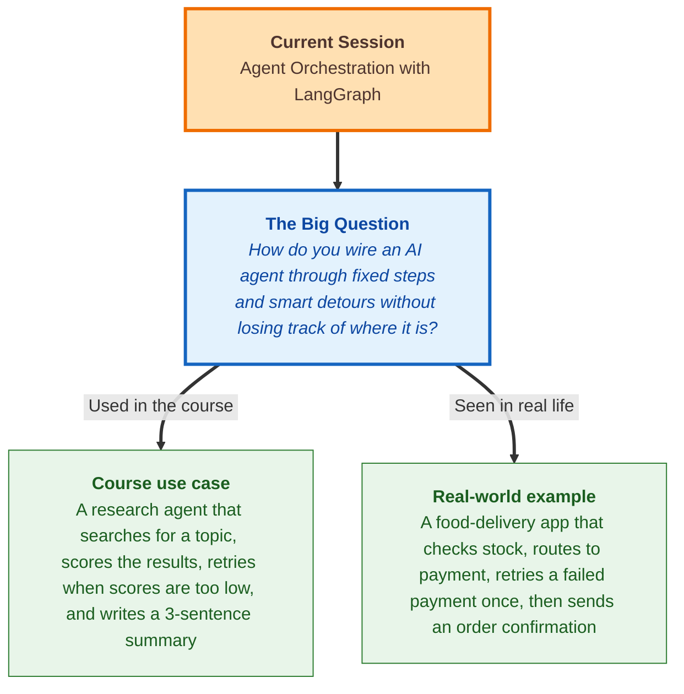

## <span style="color:#2F7DDE">Agent Orchestration with LangGraph</span>

### <span style="color:#2F7DDE">Mental Map</span>



---

### <span style="color:#2F7DDE">What You'll Learn</span>

Have you ever wondered how a food-delivery app knows to retry your payment automatically instead of cancelling your order?

By the end of this session, you will be able to:

- <span style="color:#D9660B">**Identify**</span> each step in a delivery flow and name what it does.
- <span style="color:#D9660B">**Describe**</span> how the app carries order details from the stock check all the way to the confirmation message.
- <span style="color:#D9660B">**Compare**</span> the graph-based approach with the simpler loop-based approach and name one situation where each fits.
- <span style="color:#D9660B">**Justify**</span> which approach to choose when a client asks for a research agent that must retry on low-quality results.
- <span style="color:#D9660B">**Design**</span> a branching flow where a failed payment goes to a retry step instead of ending the run.
- <span style="color:#D9660B">**Build**</span> a working multi-step agent graph with named steps, connections, and a compile call.

> <span style="color:#2F7DDE">**Topics you will meet:**</span> LangGraph StateGraph, nodes, edges, conditional edges, add_node, add_edge, compile(), state management across nodes.
> Retry handling, multi-step agent flow design, LangGraph vs AgentExecutor, when to use each.
>
> Join the session to learn each of these in detail.

---

### <span style="color:#2F7DDE">Why You Are Learning This Topic</span>

You place a food order on an app. The app checks stock, charges your card, and sends a receipt — each action is a separate step. If the charge fails, it tries once more before giving up. A <span style="color:#D9660B">**workflow graph**</span> means a map of steps with success arrows and detour arrows for failures. In this course you will build AI agents that follow the same map.

> <span style="color:#2F7DDE">**Think about it:**</span> If the payment step fails and there is no retry path, what happens next?

---

### <span style="color:#2F7DDE">The Delivery Order Puzzle</span>

Here are four steps the delivery app runs for every order.

| Step | What it does | Next step on success | Next step on failure |
|:----:|:------------:|:--------------------:|:--------------------:|
| Check stock | Confirms item is available | Charge card | Cancel order |
| Charge card | Bills the customer | Send receipt | Retry charge |
| Retry charge | Tries billing once more | Send receipt | Cancel order |
| Send receipt | Emails the confirmation | Done | — |

<span style="color:#D9660B">**What you want to happen:**</span>

- The app moves through each step in the right order.
- A failed charge sends the order to the retry step, not to cancel.
- The order details — item name, price, customer — stay available at every step.

Here is how the graph definition might start. You do not need to understand it yet.

```python
from langgraph.graph import StateGraph
graph = StateGraph(dict)
graph.add_node("check_stock", check_stock)
```

> <span style="color:#D9660B">**Wonder about this:**</span>
>
> - How does the retry step know whether this is the first attempt or the second?
> - What stops the graph from looping between charge and retry forever?

---

### <span style="color:#2F7DDE">Think It Through</span>

There is no wrong first try. Keep your guesses for the session.

**1. The stock check passes, but the charge step fails twice. What path should the order follow?**
Hint: Trace the table above row by row and follow the failure columns.

**2. The customer's name was entered at the start. The receipt step needs it. How does it get there?**
Hint: Think about what travels alongside the order from step to step.

**3. A chatbot always tries one action and retries if the model returns nothing. Would the delivery app's branching layout be worth the extra setup for that chatbot?**
Hint: Count the distinct paths the chatbot actually needs.

---

### <span style="color:#2F7DDE">One Question to Carry Into the Session</span>

> <span style="color:#2F7DDE">**How does an AI agent pass what it found at one step to the next step?**</span>
>
> Does it start fresh at each step, or does it carry a shared record through the whole run?

---

### <span style="color:#2F7DDE">Set Up Before the Session</span>

> <span style="color:#2F7DDE">**Do this before the session starts.**</span> You will install LangGraph and check that it is ready so the class can start coding right away.
>
> You already installed Python and set up an OpenRouter API key in the "Calling LLMs with OpenRouter" session. Reuse the same key here.
>
> 1. Install the libraries. In your terminal, run:
>    `pip install -U langgraph langchain langchain-openai`
> 2. Keep your OpenRouter API key ready. Set it as an environment variable named `OPENROUTER_API_KEY`, the same way you did in the earlier session.
> 3. Check that the install worked. Run:
>    `python -c "import langgraph; print(langgraph.__version__)"`
>    If it prints a version number with no error, you are ready for class.
